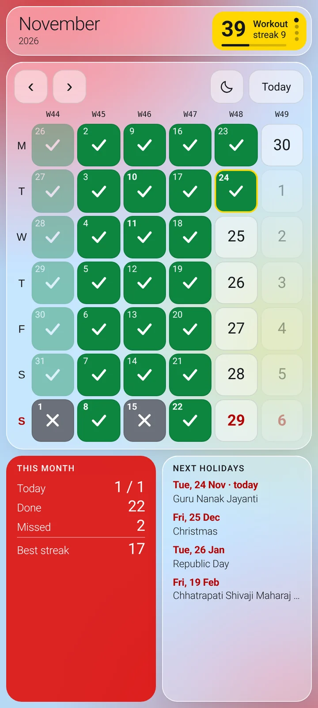
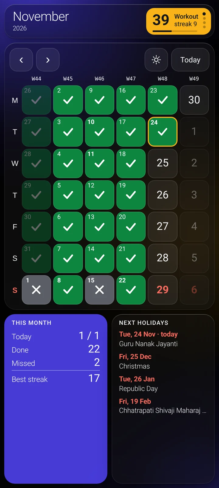
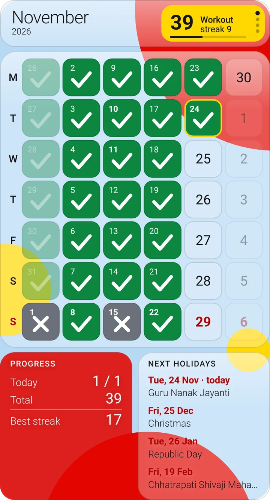

# Streak Calendar

A calm, glassy habit tracker for Android. Build habits, break bad ones or track a number, mark each day with a swipe, and keep your progress on your home screen.

  
  
  

## Download

1. On your Android phone, open the **[latest release](https://github.com/DurveshChavan/streak-calendar/releases/latest)**.
2. Tap the **StreakCalendar-v… .apk** file to download it, then open it.
3. If Android asks, allow your browser to install apps (**Settings → Install unknown apps**), then tap **Install**.
   If Play Protect warns about an unknown developer, choose **More details → Install anyway**.

Needs Android 6.0 or newer. To **update**, install the newer APK from Releases over the old one; your habits, marks and notes stay.

## Using it

- **Mark a day:** swipe a day **left** for ✓ done or **right** for ✕ missed (missed days are grey). Swipe a marked day to clear it. **Undo** appears at the bottom.
- **Day details:** tap a day to mark it, write a note, or say why a habit was missed.
- **Change month:** swipe a long way across the calendar, or use **‹ ›**. Tap the month name to jump back to today.
- **The badge** shows the habit's **total** in big numbers and its streak or this week's progress underneath. Swipe it up or down to switch habit; tap it to manage habits.
- **This month** shows today's score (how many of your every-day habits are done), plus done, missed and best streak. Tap it for the habit's details and an 8-week trend.
- **Light or dark:** the moon / sun button.
- Works in **split screen**, **pop-up view** and landscape, and with a keyboard (Tab, Enter, Escape).

### Four kinds of habit

Tap the badge → **+ New habit** and choose:

| Kind | For | Progress |
|---|---|---|
| **Every day** | Something you want daily | Day streak; only a missed day breaks it, a blank day never does |
| **Some days a week** | A goal like 3 workouts a week | "2 / 3 this week" and a week streak |
| **Break a habit** | Something you want to do less | Count the urges you resist; an optional weekly budget for the times it happens |
| **Track a number** | Pages, minutes, glasses | One number a day, a weekly total and an optional target |

- **Timers:** an every-day or weekly habit has a **Start** timer ("just start for 2 minutes"); a habit you are breaking has a **Delay** timer ("wait it out"). When it ends, the day is marked done or one resisted urge is added. It keeps running with the app closed and shows in a notification.
- **Later:** park a habit without losing its data. It is left out of scores and streaks until you **Resume** it.
- **Avoid list:** things to keep out of your life, each with what to do instead. Nothing is tracked.
- **Week starts on:** pick any weekday in the Habits sheet. Every weekly number follows it.
- **Gentle nudges:** after a missed day the app suggests a short start; after two misses in a row it asks whether to change the time or make the habit smaller. On the last day of the week a **weekly review** sums up each habit. Turn the nudges off in the Habits sheet.

## Home-screen widgets

1. Long-press an empty spot on the home screen → **Widgets** → **Streak Calendar**.
2. Pick one:
   - **4x4**: total, streak and the month calendar.
   - **4x6**: also today's score, this month's progress and the next holidays.
   - **Streak Calendar action**: one habit, its total and this week, with a button that starts its timer without opening the app.

- **Tap the badge** on the calendar widget to show the next habit. Tap anywhere else to open the app.
- **Long-press the widget → Settings** to set the **transparency** (0–100 %), the **theme** (match app, light or dark) and the **habit** it shows.

## Your data

- Everything stays on your phone. Nothing is sent anywhere unless you set up your own sync server.
- **Back up:** tap the streak badge → **Copy backup**, and keep that text somewhere safe (a note, an email to yourself).
- **Restore:** tap the streak badge → **Restore…**, paste the backup, then **Restore**. It adds to what is already there and never deletes anything, so it is also how you move to a new phone. Backups from 1.0 and 2.0 still work.
- **Updating from 2.0:** install 3.1 over it. All habits, marks and notes stay, and your habits become **Every day** habits.
- **Own sync server:** if you use one, update it to 3.1 as well. Until then 3.1 shows "Sync: the server needs an update" and keeps everything on the phone.

## License

© 2026 Durvesh Chavan. All rights reserved. You may install and use the official app from Releases for personal use; nothing else is permitted without written permission. See [LICENSE](LICENSE).
