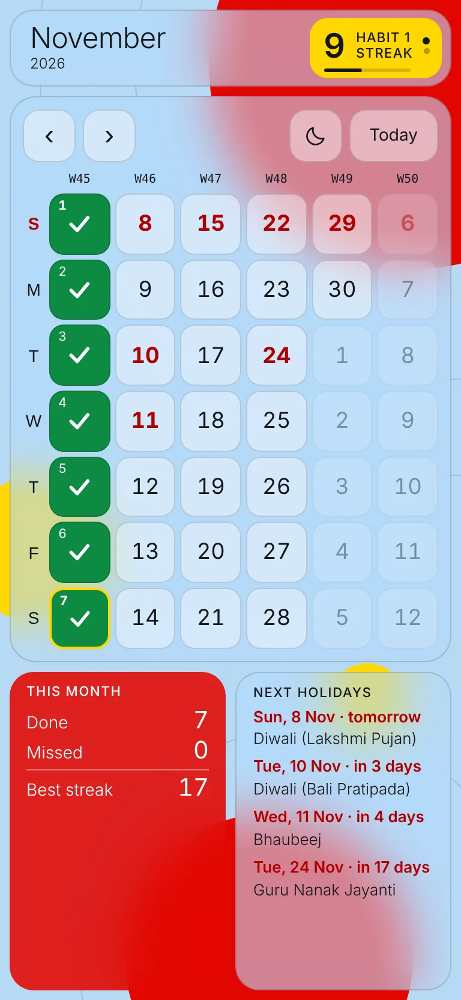
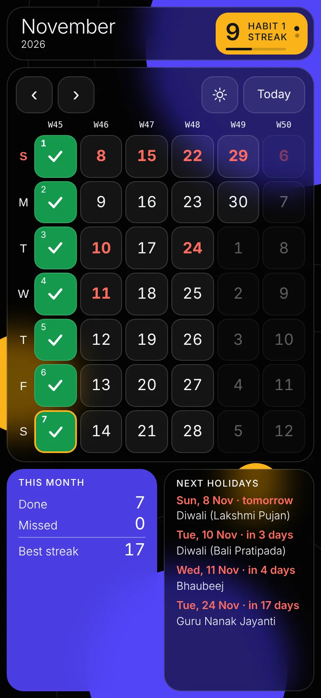
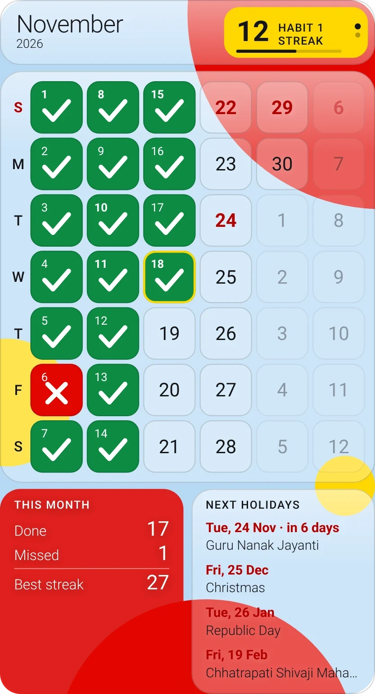

# Streak Calendar

A calm, glassy habit tracker for Android. Mark each day with a swipe, watch your streak grow, and keep it on your home screen with a see-through widget.

  
  
  

## Download

1. On your Android phone, open the **[latest release](https://github.com/DurveshChavan/streak-calendar/releases/latest)**.
2. Tap the **StreakCalendar-v… .apk** file to download it, then open it.
3. If Android asks, allow your browser to install apps (**Settings → Install unknown apps**), then tap **Install**.
   If Play Protect warns about an unknown developer, choose **More details → Install anyway**.

Needs Android 6.0 or newer. To **update**, install the newer APK from Releases over the old one; your habits, marks and notes stay.

## Using it

- **Mark a day:** swipe a day **left** for ✓ done or **right** for ✕ missed. Swipe a marked day to clear it. **Undo** appears at the bottom.
- **Change month:** swipe a long way across the calendar, or use **‹ ›**. Tap the month name to jump back to today.
- **Day details and notes:** tap a day.
- **Habits:** tap the yellow streak badge to add, rename, reorder or delete habits. Swipe the badge up or down to switch habit.
- **Light or dark:** the moon / sun button.
- Works in **split screen**, **pop-up view** and landscape.

## Home-screen widget

1. Long-press an empty spot on the home screen → **Widgets** → **Streak Calendar**.
2. Pick **4x4** (streak + calendar) or **4x6** (also this month's stats and the next holidays), and place it.

- **Tap the streak badge** on the widget to show your next habit. Tap anywhere else to open the app.
- **Long-press the widget → Settings** to set the **transparency** (0–100 %), the **theme** (match app, light or dark) and the **habit** it shows.

## Your data

- Everything stays on your phone. Nothing is sent anywhere unless you set up your own sync server.
- **Back up:** tap the streak badge → **Copy backup**, and keep that text somewhere safe (a note, an email to yourself).
- **Restore:** tap the streak badge → **Restore…**, paste the backup, then **Restore**. It adds to what is already there and never deletes anything, so it is also how you move to a new phone.

## License

© 2026 Durvesh Chavan. All rights reserved. You may install and use the official app from Releases for personal use; nothing else is permitted without written permission. See [LICENSE](LICENSE).
